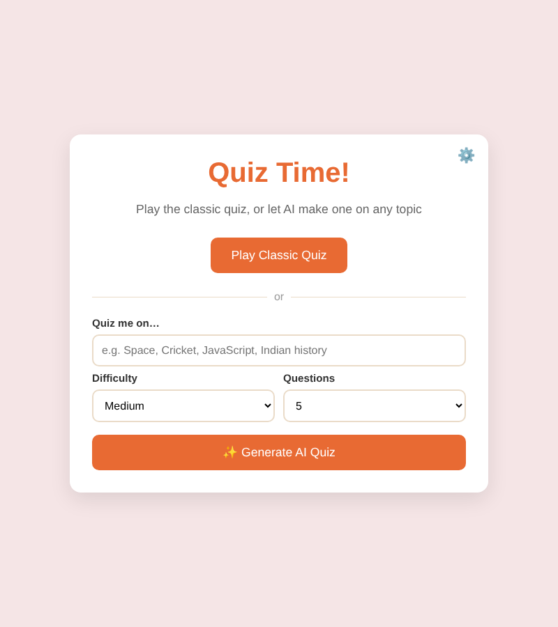
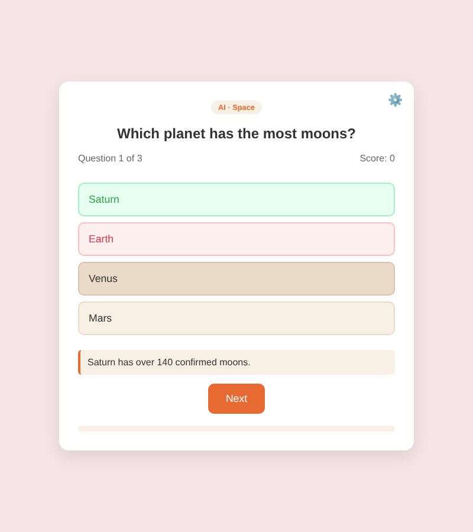
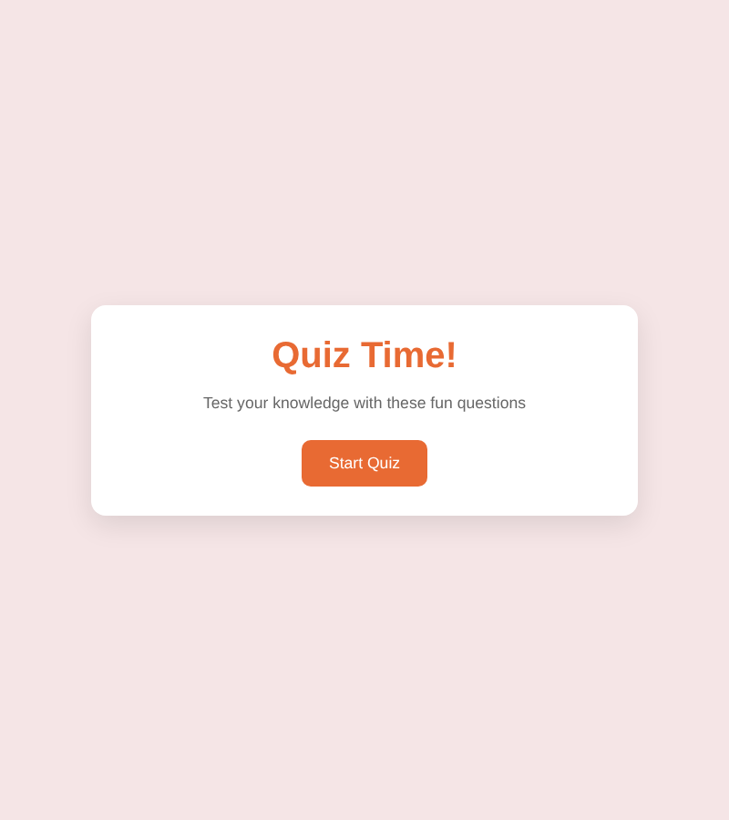
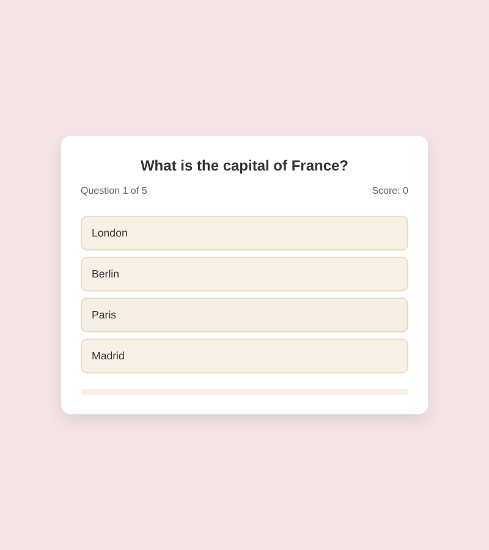

# 🧠 AI Quiz Game

A browser quiz game that started as a simple hardcoded quiz (v1) and grew into an **AI-powered quiz generator** (v2). Type any topic and **Google Gemini** writes a fresh multiple-choice quiz for you, with explanations.

**▶️ Live demo:** https://jeevansh2312.github.io/Quiz-game/
&nbsp;·&nbsp; **Original v1:** [`/v1-classic`](v1-classic/) ([live](https://jeevansh2312.github.io/Quiz-game/v1-classic/)) · tag [`v1.0-classic`](https://github.com/jeevansh2312/Quiz-game/tree/v1.0-classic)

<p>
  
  
</p>

---

## 📈 Evolution: v1 → v2

| | **v1: Classic Quiz** | **v2: AI Quiz Generator** |
|---|---|---|
| Questions | 5 hardcoded in JavaScript | Unlimited, generated on demand by an LLM, plus the original 5 as *Classic mode* |
| Topics | General knowledge only | **Any topic** the player types, with easy/medium/hard and 5 or 10 questions |
| Feedback | Right/wrong colour | Right/wrong colour, **an AI explanation** for each answer, and a review of missed questions |
| Engineering | DOM manipulation, event handling, state | All of v1, plus **REST API integration**, **structured LLM output (JSON schema)**, **output validation**, async/await, error handling, browser storage |
| Code | [`v1-classic/`](v1-classic/) | [`quiz-game/`](quiz-game/) |

<details>
<summary>v1 screenshots</summary>
<p>
  
  
</p>
</details>

## ✨ Features

- **Classic mode**: the original 5-question quiz. It works offline and needs no key.
- **AI mode**: pick a topic, difficulty and length, and Gemini generates the quiz.
- **Explanations**: a one-line explanation after every AI question.
- **Missed-questions review** on the results screen.
- **Robust to bad AI output**: invalid questions are dropped and answers are shuffled.
- **Clear errors** for a missing or invalid key, rate limits, network problems and bad responses, with a one-click fallback to Classic mode.
- **Responsive** on mobile and desktop.

## ⚙️ How AI mode works

```
topic + difficulty + count
        │
        ▼
  buildPrompt()  ──►  Gemini API (generateContent)
                      responseMimeType: application/json
                      responseSchema:   [{question, answers[{text, correct}], explanation}]
        │
        ▼
  validateQuestions()   keeps only items with 4 answers & exactly 1 correct, then shuffles them
        │
        ▼
  startQuiz(questions)  the same quiz engine as v1
```

The key idea is that the LLM is asked to return **the same data shape as the v1 question array**. So the original quiz engine (`showQuestion`, `selectAnswer`, `showResults`) runs AI quizzes almost unchanged. All the AI logic lives in [`quiz-game/ai.js`](quiz-game/ai.js).

## 🚀 Run it

1. Open the [live demo](https://jeevansh2312.github.io/Quiz-game/), or clone the repo and open `quiz-game/index.html` in a browser (no build step).
2. Classic mode works straight away.
3. For AI mode, get a **free** API key from [Google AI Studio](https://aistudio.google.com/apikey). Click ⚙️ and paste it in.

> 🔐 **About the API key:** this is a static site with no backend, so it uses a *bring-your-own-key* approach. Your key is stored only in your browser's `localStorage` and is sent only to Google's API. Never commit API keys to a repo.

The model defaults to `gemini-flash-latest` and can be changed in ⚙️ Settings.

## 🛠️ Tech stack

HTML5 · CSS3 (Flexbox, Grid, media queries) · Vanilla JavaScript (ES2020+, async/await, Fetch API) · Google Gemini API (structured output) · GitHub Pages

## 📂 Project structure

```
├── index.html          # redirects to the app (GitHub Pages entry)
├── quiz-game/          # v2 app
│   ├── index.html
│   ├── style.css
│   ├── script.js       # quiz engine, screens, settings
│   ├── questions.js    # the original v1 questions (Classic mode)
│   └── ai.js           # Gemini prompt, JSON schema, validation
├── v1-classic/         # the original v1, untouched
└── docs/screenshots/
```

## 📚 What I learned

- Building an interactive UI with plain DOM APIs and keeping quiz state simple (v1)
- Calling an LLM from JavaScript and **prompt design** for consistent results
- Using **structured output / JSON schemas** so an LLM returns data my code can rely on
- **Never trusting model output**: validating, filtering and shuffling AI responses
- Handling real-world API failures (auth, rate limits, network) gracefully
- Shipping a static app with GitHub Pages, and handling API keys safely without a backend

## 🗺️ Ideas for next steps

- Small backend proxy (e.g. Cloudflare Worker) so visitors don't need their own key
- Timer mode and a leaderboard
- "Quiz me on this text": paste notes and the AI makes a quiz from them
